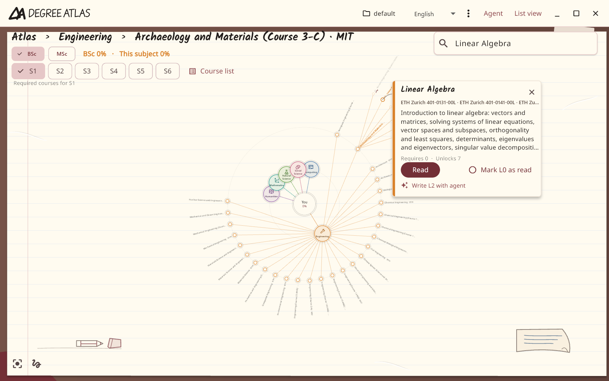

<p align="center">
  <picture>
    <source media="(prefers-color-scheme: dark)" srcset="app/assets/brand/degree-atlas-wordmark-light.svg">
    
  </picture>
</p>

<p align="center">
  <b>University-level study material at four depths, written by your AI agent from real course lists and browsed in a radial atlas.</b>
</p>

<p align="center">
  <a href="LICENSE"></a>
  
  
</p>

<!-- Add a screenshot of the atlas here:  -->

## Why this exists

Every university publishes what it teaches: study plans, course lists, descriptions, sometimes whole lecture notes. Put side by side, those plans say a lot about what a field really consists of, which subjects come first, and what each one builds on. But they are scattered across catalogs, written for enrolled students, and impossible to read as a whole.

Meanwhile, anyone who has tried to teach themselves a subject knows the other problem. A search gives you a hundred explanations at random depth. A textbook assumes you read the previous one. Nothing tells you what to learn first, or whether you are ready for the next step. And if you are already enrolled, your own notes are a pile of PDFs with no order and no practice.

Degree Atlas tries to fix both. It reads real degree programs, merges the courses they share into single subjects, and lays them out as a map with prerequisites. For each subject, your AI agent writes the material at the depth you need, and the app lets you read it, practise it and see how far you have come. Pick a field, follow the map, go deeper when you are ready.

## How it helps

- **You want to learn a field, not enrol in it.** Say "I want to learn chemical engineering". The agent finds real programs that teach it, builds the subjects in the order a degree would, and starts with a one-page explanation of each, so you see the whole landscape before you commit to the details.
- **You are studying a course and drowning in your own material.** Import the folder with your slides, notes and past exams. You get a gentle introduction from the ground up, then a deeper level that follows your course's own structure and notation, and practice problems in the style of your exams.
- **You want to go deep.** Each subject goes through four levels, from an explanation anyone can follow to the open questions researchers are working on today.

The material is only as good as the agent and the sources it reads, so it is written to cite what it actually read, and every level has a "report a problem" button that sends the fix back to the agent. Treat it like a smart study partner, not like a textbook.

No API keys, no accounts, no hosted service. It drives a coding agent you already use (Claude Code or Codex). Your data, progress and imported files are stored only on your machine; the agent you choose reads them the way it reads any file you give it.

## What is in it

| Level | Goal |
| --- | --- |
| **L0** ELI5 | the concept, main methods and lessons in about one page |
| **L1** Basics | main ideas and key terms, a few pages |
| **L2** Master crash course | methods, derivations, solved problems |
| **L3** Research frontier | state of the field and open questions, dated |

- **A radial atlas.** You in the centre, then domains, degrees and subjects. Courses shared by several degrees or universities are one subject, so subjects form a prerequisite graph.
- **Practice.** Graded exercises per subject: multiple choice, numeric, short answer and open problems. Your results are tracked.
- **Your own course materials.** Import a folder of notes, slides, problem sets and past exams. You get an elementary introduction (L0, L1), a mastery level (L2) that follows your course, and exercises in the style of your exams.
- **Profiles.** Start empty (only the domains), say "I want to learn material science", and the agent builds it. Profiles can be renamed, deleted, exported and imported.
- **Languages.** Read and generate in 13 languages, translate existing material with the agent.
- **In-app agent.** A chat panel connected to a Claude Code session, with a window to check and sign in to your Claude connection.

## Quick start

```bash
git clone https://github.com/wpowertechgit/degree-atlas.git
cd degree-atlas
python scripts/setup.py          # Python deps, Flutter build, local folders, validation
```

Or open the repo in Claude Code and say "set this up" (see **Setup after clone** in [AGENTS.md](AGENTS.md)). Then start the viewer with `launch.bat` on Windows, or run the built app under `app/build/`.

You need Python 3.10+, the Flutter SDK (`setup.py --install-flutter` can fetch it), and Claude Code or Codex for the writing. Windows needs Visual Studio with the C++ desktop workload for the Flutter build.

**First run:** open the profile menu, create an empty profile, open the Agent panel and tell it what you want to learn. Or use **Data → Import course materials…** to start from your own files.

## How it works

```
scout  ->  mapper  ->  writer  (-> optional verifier)
```

1. The **scout** reads a degree's public study plan and course catalog.
2. The **mapper** merges equivalent courses into subjects and builds degrees, domains and prerequisite links.
3. The **writer** produces L0 to L3 and exercises, citing the sources it actually read.

Everything an agent needs to know is in [AGENTS.md](AGENTS.md): the workflow, level specs, languages, exercises and the rules for your own materials. `python scripts/validate.py` checks all data against the schemas in `schemas/`.

## What is in this repo

```
AGENTS.md          the agent workflow and rules (Claude Code and Codex)
app/               Flutter desktop viewer
scripts/           mapper, validator, work queue, setup
schemas/           JSON Schemas for the data files
.claude/agents/    scout, mapper, writer, verifier definitions
catalogs.json      example catalog sources (MIT, ETH Zurich, NUS)
data/domains/      domain groupings (committed)
data/              universities/, degrees/, subjects/ are generated locally and gitignored
profiles/          your personal data sets (gitignored)
```

The repository deliberately contains **no scraped catalog data and no generated study text**. You build those locally from public catalogs, which keeps licensing clean. Your own materials stay on your machine too.

## The viewer in detail

- **Atlas:** colours follow the domain, a BSc/MSc toggle switches the level, and clicking a subject opens its brief. Marking a level as read feeds animated progress, stored in `progress.json` (personal, gitignored).
- **Reading overlay:** L0 to L3 tabs plus Practice, report-a-problem, regenerate, and translate buttons that hand the request to the agent.
- **Data menu:** exports everything under `data/` plus your progress into a single-line JSON file (the data is LZW-compressed and base64-encoded in its `payload` field), and imports one. Same-path files are overwritten, progress is merged. Imported course materials are not part of the export.
- **Design:** the course reader uses a handwritten course-binder style, see [DESIGN.md](DESIGN.md).

## Contributing

Issues and pull requests are welcome, see [CONTRIBUTING.md](CONTRIBUTING.md). For security questions, including how the in-app agent is permissioned, read [SECURITY.md](SECURITY.md).

## License

MIT, see [LICENSE](LICENSE). The bundled Kalam font and the line-md icons keep their own licenses (see `app/assets/`). Generated study material and any catalog data you build locally are yours to handle under the terms of their sources.
